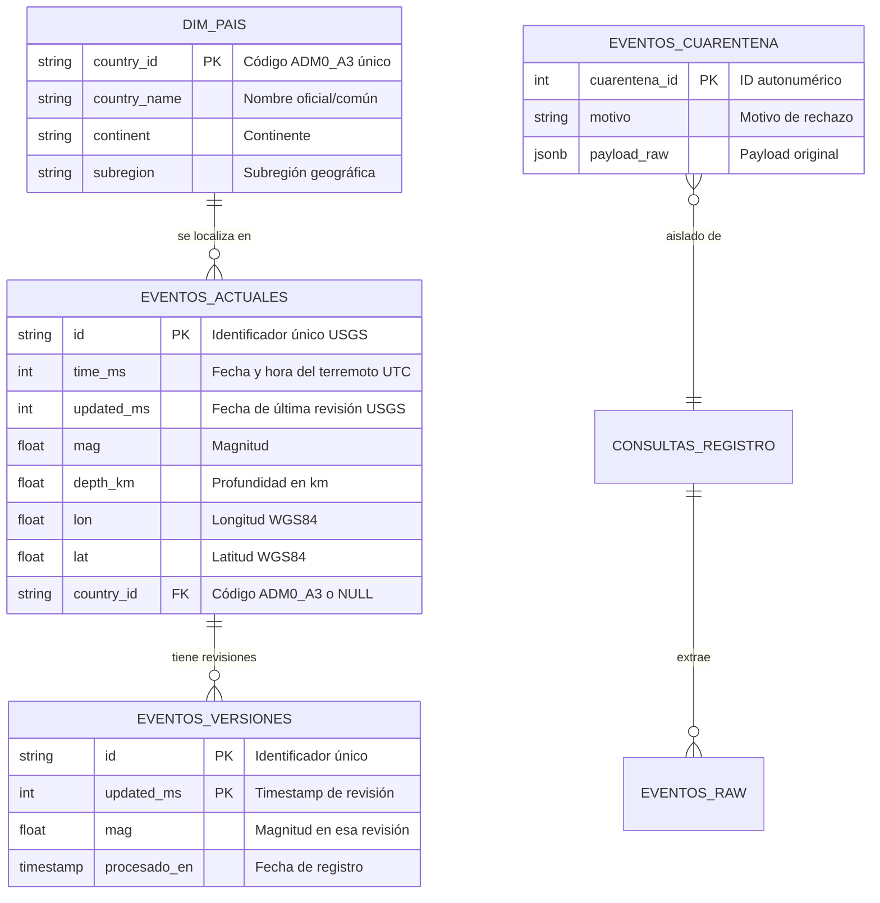
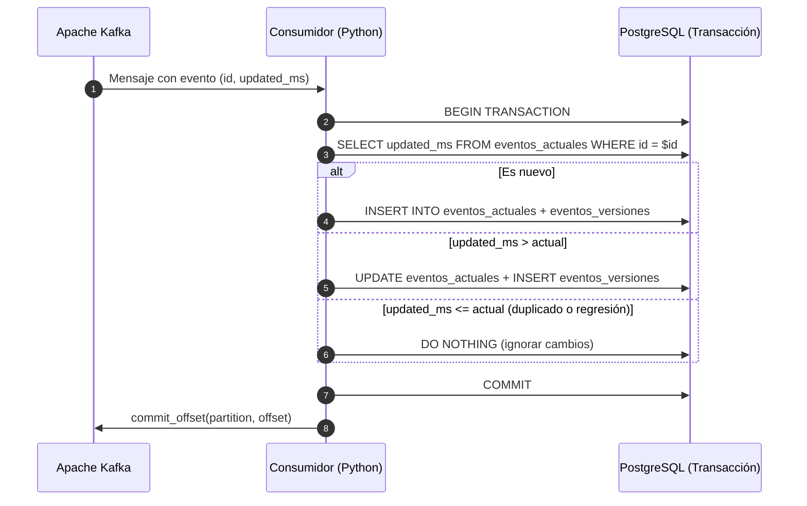

# Modelo de Datos e Integración (Punto 7)

## 1. Modelo Conceptual

El sistema procesa y almacena eventos sísmicos integrando dos fuentes heterogéneas:
1. **USGS Earthquake API** (feed en tiempo real y catálogo histórico de terremotos).
2. **Natural Earth** (catálogo geográfico vectorial de fronteras de países, WGS84).



---

## 2. Grano y Claves

| Entidad / Tabla | Grano (Qué representa 1 fila) | Clave Primaria (PK) | Claves Foráneas (FK) |
|---|---|---|---|
| `eventos_actuales` | Estado vigente de 1 terremoto individual | `id` (VARCHAR) | `country_id` → `dim_pais(country_id)` |
| `dim_pais` | 1 país o territorio geográfico | `country_id` (ADM0_A3) | - |
| `eventos_versiones` | 1 versión/revisión observada de 1 terremoto | `(id, updated_ms)` | - |
| `eventos_raw` | 1 carga original recibida desde el feed USGS | `(id, updated_ms)` | - |
| `eventos_cuarentena` | 1 evento rechazado por incumplir validación | `cuarentena_id` | - |
| `productor_estado` | Último estado publicado hacia Kafka | `id` | - |
| `consultas_registro` | 1 ciclo de polling HTTP a USGS | `consulta_id` | - |
| `transformaciones_log` | 1 lote de procesamiento del consumidor | `log_id` | - |

---

## 3. Modelo Físico y Justificación de Índices

### Tablas e Índices Creados

```sql
-- 1. Tabla de Hechos: eventos_actuales
CREATE TABLE eventos_actuales (
    id              TEXT PRIMARY KEY,
    time_ms         BIGINT NOT NULL,
    updated_ms      BIGINT NOT NULL,
    ingested_at_ms  BIGINT NOT NULL,
    procesado_en    TIMESTAMPTZ NOT NULL DEFAULT NOW(),
    mag             NUMERIC(5,2),
    mag_type        TEXT,
    place           TEXT,
    lon             DOUBLE PRECISION NOT NULL,
    lat             DOUBLE PRECISION NOT NULL,
    depth_km        DOUBLE PRECISION,
    country_id      TEXT REFERENCES dim_pais(country_id) ON DELETE SET NULL,
    country_name    TEXT,
    continent       TEXT,
    subregion       TEXT,
    source          TEXT NOT NULL DEFAULT 'usgs_live',
    mode            TEXT NOT NULL DEFAULT 'live',
    mag_nula        BOOLEAN NOT NULL DEFAULT FALSE,
    mag_negativa    BOOLEAN NOT NULL DEFAULT FALSE,
    depth_nula      BOOLEAN NOT NULL DEFAULT FALSE,
    depth_negativa  BOOLEAN NOT NULL DEFAULT FALSE,
    place_nulo      BOOLEAN NOT NULL DEFAULT FALSE,
    sin_pais        BOOLEAN NOT NULL DEFAULT FALSE
);

-- Índices en eventos_actuales:
CREATE INDEX idx_ev_act_time    ON eventos_actuales (time_ms DESC);
CREATE INDEX idx_ev_act_country ON eventos_actuales (country_id);
CREATE INDEX idx_ev_act_mag     ON eventos_actuales (mag);
CREATE INDEX idx_ev_act_mode    ON eventos_actuales (mode);
```

### Justificación Técnica de los Índices

1. **`idx_ev_act_time` (time_ms DESC)**:
   - *Justificación*: El endpoint `/api/eventos` filtra por defecto las últimas 24 horas y ordena cronológicamente. Un índice B-tree sobre `time_ms DESC` permite aplicar `time_ms >= $start` mediante un *Index Scan* sin ordenar en memoria.
2. **`idx_ev_act_country` (country_id)**:
   - *Justificación*: Optimiza los filtros opcionales de la API (`?country_id=ESP`) y las consultas analíticas de agregación por país en `/api/estadisticas`. Además, acelera la verificación de integridad de la clave foránea con `dim_pais`.
3. **`idx_ev_act_mag` (mag)**:
   - *Justificación*: El frontend y la API ofrecen filtrado por magnitud mínima (`?min_mag=4.0`). El índice B-tree descarta rangos de baja magnitud instantáneamente.
4. **`idx_ev_act_mode` (mode)**:
   - *Justificación*: Aísla completamente los registros en tiempo real (`live`) de los generados durante simulaciones o pruebas (`replay`).
5. **`idx_ev_ver_id` en `eventos_versiones(id)`**:
   - *Justificación*: Permite recuperar rápidamente la trazabilidad histórica y evolución de revisiones de cualquier evento particular.

---

## 4. Semántica At-Least-Once e Idempotencia Transaccional

El sistema no utiliza un coordinador de transacciones distribuidas (XA) entre Kafka y PostgreSQL, sino un patrón de **escritura idempotente con confirmación posterior de offsets**:



### ¿Qué ocurre si falla un contenedor?

1. **Si el consumidor cae antes del COMMIT de PostgreSQL**:
   - PostgreSQL deshace la transacción (*rollback* automático).
   - Kafka no recibe la confirmación del offset.
   - Al reiniciar el consumidor, Kafka vuelve a entregar el mensaje y se procesa limpiamente sin inconsistencias.
2. **Si el consumidor cae entre el COMMIT de Postgres y el commit de Kafka**:
   - Los datos ya están seguros en la base de datos.
   - Kafka reenviará el mensaje al siguiente consumidor.
   - El consumidor ejecuta la comprobación de versión (`updated_ms <= actual`): detecta que la versión ya está registrada y **no incrementa el contador ni duplica registros**.
3. **Llegada de versiones desordenadas**:
   - Si por latencia de red una versión antigua llega después de una nueva, la comparación `updated_ms > actual` protege el estado vigente evitando que datos obsoletos sobrescriban información más reciente.
